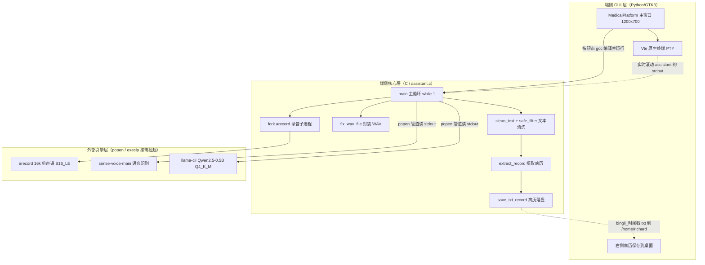
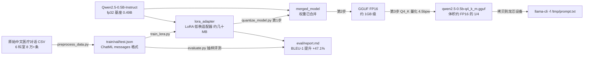

# loongson-medical-core 源码详解 00：总览与架构

> **涉及文件**
> - `embedded-application/assistant.c`（314 行原码，注释后 407 行）—— 语音病历助手主程序
> - `embedded-application/medical-platform/medical_platform.py`（204 行原码，注释后 223 行）—— GTK3 桌面壳
> - `model-training/scripts/`（5 个 Python 脚本，841 行原码）—— 数据/训练/量化/评估流水线
> - `inference-engine/`、`speech-engine/` —— 模型资产（仓库内为 Git LFS 指针，真实权重部署在目标机）

---

## 1. 工程定位

**loongson-medical-core** 是一套跑在龙芯（LoongArch）嵌入式 Linux 上的**全离线**医疗辅助系统：

1. 医生/患者对着麦克风说话 → 本地 SenseVoice 语音识别；
2. 识别文本交给本地 Qwen2.5-0.5B（LoRA 微调 + Q4_K 量化）生成四段式门诊病历；
3. 助手程序把病历渲染成带 ASCII 边框的 TXT 落盘，执业医师签字后生效。

整机**不联网**：模型权重、语音识别、推理全部在本地完成，主打"隐私安全 + 离线可用"。

## 2. 目录结构总表

| 目录/文件 | 角色 | 语言 | 备注 |
|---|---|---|---|
| `embedded-application/assistant.c` | 端侧核心：录音→识别→生成→病历落盘 | C | gcc 直接编译，无第三方依赖 |
| `embedded-application/medical-platform/medical_platform.py` | 端侧 GUI：GTK3 + Vte 终端壳 | Python | 三面板布局 |
| `embedded-application/medical-platform/run.sh` | GUI 启动脚本 | Bash | export LD_LIBRARY_PATH 后拉起 GUI |
| `embedded-application/medical-platform/loongson-medical-platform.desktop` | 桌面快捷方式 | ini | 双击进系统菜单 |
| `model-training/scripts/preprocess_data.py` | 训练第 1 步：CSV→ChatML JSON | Python | 6 科室、90/5/5 分层划分 |
| `model-training/scripts/train_lora.py` | 训练第 2 步：LoRA 微调 Qwen2.5-0.5B | Python | r=8，CPU 可跑 |
| `model-training/scripts/quantize_model.py` | 训练第 3 步：合并 LoRA→GGUF→Q4_K | Python | 四步幂等流水线 |
| `model-training/scripts/quantize_iq1s.py` | 训练第 3 步备选：Q4_K 独立重实现 | Python | 手工搬 GGUF 元数据 |
| `model-training/scripts/evaluate.py` | 训练第 4 步：基座 vs LoRA 对比评估 | Python | 字符级 BLEU-1 |
| `inference-engine/*.gguf` | Qwen2.5-0.5B q4_k_m 权重 | 二进制 | LFS 指针（134 B） |
| `speech-engine/sense-voice-main` | SenseVoice 识别器可执行 | 二进制 | 随 llama.cpp 生态构建 |
| `speech-engine/*.gguf` | SenseVoice-Small q4_k 权重 | 二进制 | LFS 指针 |

## 3. 三层架构

端侧运行时是**一个 Python GUI 进程 + 一个 C 助手进程 + 三个按需拉起的外部进程**（录音、识别、推理）构成的星型结构；训练侧是一条**离线五脚本流水线**，产物（Q4_K GGUF）从 PC 拷到龙芯设备供端侧消费。

训练侧：

## 4. 模型资产一览

| 资产 | 架构 | 参数量 | 关键规格 | 仓库内形态 |
|---|---|---|---|---|
| `qwen2.5-0.5b-instruct-q4_k_m.gguf` | Qwen2（GQA） | 0.49B（非嵌入 0.36B） | 24 层，Q 头 14 / KV 头 2，hidden=896，词表 15 万级 | LFS 指针 |
| `sense-voice-small-q4_k.gguf` | SenseVoice-Small | — | Q4_K 量化，16 kHz 输入 | LFS 指针 |
| `models/lora/adapter_config.json` | LoRA 适配器 | 可训参数 < 1% | r=8 / alpha=16 / dropout=0.05 | 已提交 |
| `models/merged/` | 合并后模型 | 0.49B fp32 | 仅 config/tokenizer 元数据入仓 | LFS |

> Qwen2.5-0.5B 上下文 32K、生成上限 8K；本项目为控时延把端侧推理压到 `-c 512 -n 128`。

## 5. 端侧一次问诊的完整数据流

数据载体尺寸都是硬编码的栈上缓冲（4KB/8KB/2KB），全部有长度守卫；链路上唯一的"持久化"是 `/tmp` 两个音频临时文件和最终的病历 TXT。

## 6. 仓库内外两套"事实"

仓库 ≠ 设备。仓库里有三样东西只是**占位**：`inference-engine/*.gguf`、`speech-engine/*.gguf`（Git LFS 指针，各 134 字节）、`data/processed/*.json`（LFS 指针，真实训练集 600 MB+）。真正跑通系统依赖的权重在部署机 `/home/richard/` 下，或由第 4 篇的训练流水线现场生成。读码时看到"文件多大"要以 `git lfs pull` 后或目标机上的实测为准。

## 7. 五篇精读的读码路径

| 篇目 | 内容 | 建议读法 |
|---|---|---|
| [01-启动与初始化](01-启动与初始化.md) | GUI 三面板搭建、spawn 编译运行、C 端清场与主循环进入 | 先看本篇建立进程视角 |
| [02-核心子系统精读](02-核心子系统精读.md) | 录音/WAV 封装/清洗/提取/病历渲染/Prompt 工程 逐函数 | 对着 assistant.c 读 |
| [03-数据流与接口协议](03-数据流与接口协议.md) | WAV 头、ChatML、stdout 文本协议、GGUF 格式、训练数据流 | 当接口手册查 |
| [04-构建运行与实测指南](04-构建运行与实测指南.md) | 编译、运行、训练复现、实测 BLEU 数据、陷阱清单 | 动手前必读 |

对应 KB（逐函数表 + 代码摘录）：

| 源文件 | KB 条目 |
|---|---|
| `assistant.c` | [assistant.md](../../../05-学习笔记与知识库/Knowledge-Base/loongson-medical-core/assistant.md) |
| `medical_platform.py` | [medical_platform.md](../../../05-学习笔记与知识库/Knowledge-Base/loongson-medical-core/medical_platform.md) |
| `preprocess_data.py` | [preprocess_data.md](../../../05-学习笔记与知识库/Knowledge-Base/loongson-medical-core/preprocess_data.md) |
| `train_lora.py` | [train_lora.md](../../../05-学习笔记与知识库/Knowledge-Base/loongson-medical-core/train_lora.md) |
| `quantize_model.py` | [quantize_model.md](../../../05-学习笔记与知识库/Knowledge-Base/loongson-medical-core/quantize_model.md) |
| `quantize_iq1s.py` | [quantize_iq1s.md](../../../05-学习笔记与知识库/Knowledge-Base/loongson-medical-core/quantize_iq1s.md) |
| `evaluate.py` | [evaluate.md](../../../05-学习笔记与知识库/Knowledge-Base/loongson-medical-core/evaluate.md) |

## 8. 端侧进程与资源视图

一轮问诊期间设备上的进程树与内存占用（量化估算）：

| 进程 | 生命周期 | 常驻内存 | 峰值来源 |
|---|---|---|---|
| `python3 medical_platform.py` | GUI 全程 | GTK3 约 40~60 MB | Vte 回滚 5000 行 |
| `bash -c gcc && assistant` | 点"开始服务"起 | 忽略 | gcc 编译期约 20~30 MB，1~2 秒 |
| `assistant` | 主循环全程 | 栈上缓冲约 20 KB + 代码段 | popen 管道缓冲 |
| `arecord`（fork+exec） | 每轮：提示后到回车 | ALSA 插件层数 MB | 录音 DMA 缓冲 |
| `sense-voice-main` | 每轮 1~3 秒 | 模型 + 运行时数百 MB | SenseVoice q4_k 权重全量驻留 |
| `llama-cli` | 每轮 10~30 秒级 | Q4_K 权重约 270 MB + KV cache（-c 512） | `-t 2` 双线程计算 |

关键时延量化（端侧全离线）：录音 = 说话时长；STT ≈ 音频时长 × 0.1~0.3（16k 输入、-t 2）；LLM 生成 128 token 在 0.5B Q4_K 上约每秒数 token。同步机制一览：GUI↔assistant 用 PTY 字节流；assistant↔引擎用 popen 管道；录音停止用 SIGKILL；进程清理用 waitpid + GLib DO_NOT_REAP_CHILD + pidof 自清。

## 9. 设计取舍速评

| 决策 | 代价 | 收益 |
|---|---|---|
| GUI 用 Vte 真终端而非文本框 | 界面像终端、无法做富控件 | `getchar()`/Ctrl+C/子进程语义零改造 |
| 每次点按钮重新 gcc | 1~2 秒延迟 | 源码改动即时生效，无独立构建步骤 |
| 录音"先录后停"+SIGKILL | 录音无预览/无取消 | 交互只有"说话→回车"一步 |
| 三处手拼 ChatML | 改模板要改 3 处 | 训练与推理格式逐字节可控 |
| 每步量化失败降级 F16 | 单张异常只告警 | 流水线永不因单张量中断 |

## 10. 扩展指南：改什么要动哪些文件

| 扩展需求 | 必改文件 | 同步点 |
|---|---|---|
| 新增科室数据 | preprocess_data.py `DEPARTMENTS`（L20-L28） | CSV 文件名/列名进同义词表；重跑全流水线 |
| 更换声卡/麦克风 | assistant.c L335（arecord `-D`） | fix_wav_file 头字段无需改（参数不变时） |
| 更换采样率/位宽 | assistant.c L335 + L80-L86 | 两处必须一致 |
| 更换基座模型 | 训练全链 + assistant.c L374-L378 + quantize_model.py L79-L81 | ChatML 模板若变，三处手拼同步；BOS/EOS id 重核 |
| 调整病历栏目 | assistant.c L264-L281（prompt）+ L199-L252（渲染） | extract_record 标记串不变则无需动 |
| 换部署用户 | assistant.c 6 处路径 + medical_platform.py L17-L21 | 全部硬编码，全局搜 `/home/richard` |
| GUI 改交互 | medical_platform.py | 控制字节 `\n`/`\x03` 与 C 端 getchar 耦合 |

## 11. 术语速查表

| 术语 | 本工程语境下的含义 |
|---|---|
| ChatML | Qwen2 系对话模板：`\<\|im_start\|\>角色\n内容\<\|im_end\|\>`，三处手拼见第 3 篇 |
| GQA | 分组查询注意力：Qwen2.5-0.5B 用 2 个 KV 头服务 14 个 Q 头，KV cache 缩到 1/7 |
| LoRA | 低秩适配微调：只训注入线性层的 A/B 旁路矩阵，r=8/alpha=16 |
| merge_and_unload | 把 LoRA 旁路按 W←W+B·A·(α/r) 数学合并进基座后卸载旁路 |
| GGUF | llama.cpp 权重容器：header + KV 元数据 + 张量三段式 |
| Q4_K / 4.5 bpw | 256 元素超块的低比特量化，每参数约 4.5 bit，体积约 FP16 的 1/4 |
| Vte | GTK3 的终端仿真组件（libvte），自带 PTY，本工程 GUI 的核心依赖 |
| PTY | 伪终端；GUI 与 assistant.c 之间唯一的运行期通道 |
| RIFF/WAV | 波形容器格式；fix_wav_file 手工补 44 字节头 |
| BLEU-1（字符级） | evaluate.py 的字符集合重叠率，仅限同条件 A/B 相对比较 |

## 12. 已知问题清单（读码发现，均未修改代码）

1. `fix_wav_file` 中 `wav_f` 未判空——`fopen` 失败时 `fwrite(NULL)` 会段错误（见 [assistant.md](../../../05-学习笔记与知识库/Knowledge-Base/loongson-medical-core/assistant.md)）。
2. 病历输出路径 `/home/richard/`、声卡序号 `plughw:1,0`、SenseVoice 私有库路径均为硬编码，换机部署要同步改 3 处以上。
3. `medical_platform.py` 的 `on_save` 用裸 `except: pass` 吞掉保存失败，用户无感知。
4. `evaluate.py` 从 user 首行解析科室名时 `split("：")[1]` 未剔除右书名号，实测报告里科室显示为"早泄】"。
5. 训练与端侧推理对 ChatML 模板各写了一份手拼实现（3 处），改模板要同步改——没有单一事实来源。
