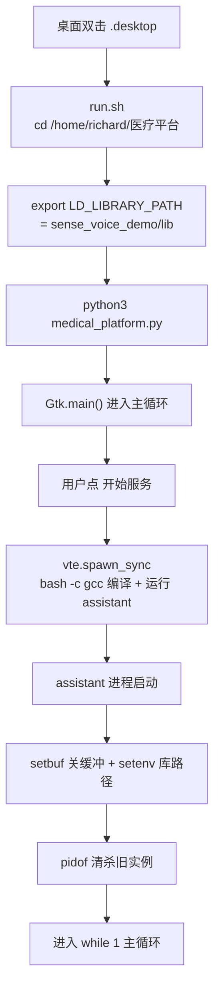
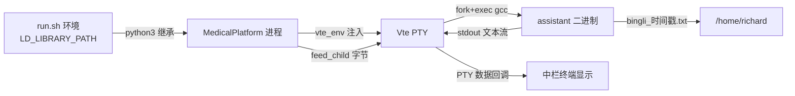
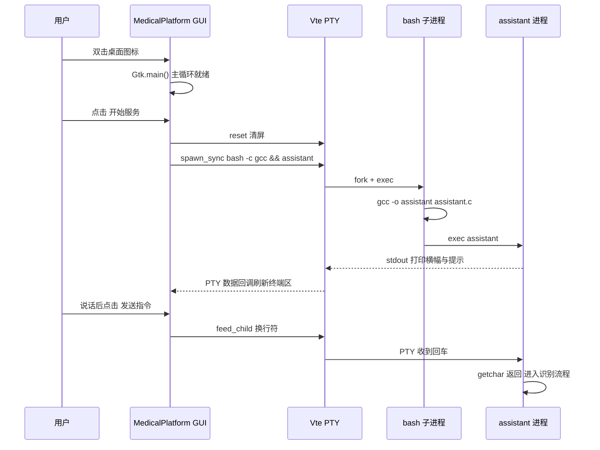

# loongson-medical-core 源码详解 01：启动与初始化

> **涉及文件**
> - `embedded-application/medical-platform/medical_platform.py`（注释后 223 行）
> - `embedded-application/assistant.c`（注释后 407 行）
> - `embedded-application/medical-platform/run.sh`
> - `embedded-application/medical-platform/loongson-medical-platform.desktop`

---

## 1. 启动链路全景

端侧有两个"启动"要分清：**GUI 壳的启动**（一次性）和 **C 助手的启动**（每次点"开始服务"都重来一遍，包括重新 gcc 编译）。整条链路是：



三份启动配置文件各管一段，职责互不重叠：

| 文件 | 职责 | 关键内容 |
|---|---|---|
| `loongson-medical-platform.desktop` | 让系统菜单认识本应用 | `Exec=bash /home/richard/医疗平台/run.sh`，`Terminal=false` |
| `run.sh` | 环境准备 + 拉起 GUI | `export LD_LIBRARY_PATH=/home/richard/sense_voice_demo/lib:$LD_LIBRARY_PATH` |
| `medical_platform.py` | 构建 GUI、按需编译并运行 C 助手 | `LAUNCH_CMD` 一条命令串起 gcc 和 assistant |

## 2. GUI 侧初始化（medical_platform.py）

先把启动期的数据流摆出来——两个进程之间没有任何 IPC 原语，全靠 PTY 字节流与文件：



### 2.1 模块级：钉死 GTK 组件版本

```python
# medical_platform.py L10-L12
gi.require_version('Gtk', '3.0')
gi.require_version('Vte', '2.91')
gi.require_version('Pango', '1.0')
from gi.repository import Gtk, Gdk, GLib, Pango, Vte
```

`gi.require_version` 必须在 `from gi.repository import ...` **之前**执行：PyGObject 若不钉版本会默认加载最新 API，Vte 2.91 与 2.90 之前的接口不兼容，导入顺序错了直接 AttributeError。

### 2.2 四个常量决定整个部署形态

```python
# medical_platform.py L17-L21
ASSISTANT_SRC  = "/home/richard/assistant.c"   # 助手 C 源码（仓库 embedded-application/assistant.c 的部署副本）
ASSISTANT_BIN  = "/home/richard/assistant"     # 每次点"开始服务"都会重新编译出的可执行文件
DESKTOP        = os.path.expanduser("~/Desktop")  # 右侧面板"保存病历"的目标目录
LAUNCH_CMD     = "gcc -o " + ASSISTANT_BIN + " " + ASSISTANT_SRC + " && " + ASSISTANT_BIN
```

`LAUNCH_CMD` 用 `&&` 串联：**编译失败就不会运行旧二进制**，这是一个隐式的"编译门禁"。代价是每次点按钮都全量重编一次 314 行的 C 文件——龙芯设备上 gcc 一遍约 1~2 秒，可接受。

### 2.3 __init__：三面板布局的装配顺序

`MedicalPlatform.__init__`（L28 起）按"外框 → 左 → 中 → 右 → CSS"的顺序装配：

| 顺序 | 控件 | 关键行 | 作用 |
|---|---|---|---|
| 1 | `outer` / `inner` 两个 Paned | L36-L38 | 嵌套水平分割：左 \|（中 \| 右），分隔条可拖 |
| 2 | 左栏 `left`（270px 宽） | L41 起 | 标题 + 简介 + 三个按钮 |
| 3 | `btn_start`（56px 高） | L67-L75 | 主操作视觉权重，点击触发 `on_start` |
| 4 | 中栏 `Vte.Terminal` | L97 起 | 真终端（PTY），scrollback 5000 行 |
| 5 | `self.vte_env` | L103-L104 | 给子进程注入 `LD_LIBRARY_PATH` |
| 6 | 右栏 TextView + 保存按钮 | L111 起 | 粘贴病历 → 桌面 `病例.txt` |
| 7 | CSS `#left-panel` | L142-L144 | 左栏浅灰底色区分控制区 |

中栏为什么用 Vte 而不是 TextView 是理解本文件的关键：assistant.c 里 `while (getchar() != '\n')` 阻塞读回车、`popen` 拉起的子进程要在"真终端"语义下工作（信号、行缓冲、TERM），这些都是 TextView 给不了的。Vte 自带 PTY，`spawn_sync` 直接把 bash 塞进去，assistant 就像在黑窗口里跑一样。

### 2.4 on_start：编译 + 运行的启动点

```python
# medical_platform.py L149-L165
    def on_start(self, btn):
        # 按钮状态机：开始置灰，发送/停止解锁（防重复 spawn）
        self.btn_start.set_sensitive(False)
        self.btn_send.set_sensitive(True)
        self.btn_stop.set_sensitive(True)

        # 清空终端，启动编译 + 运行
        self.vte.reset(True, True)   # True,True = 清屏 + 清回滚
        self.vte.spawn_sync(
            Vte.PtyFlags.DEFAULT,
            "/home/richard",                    # 子进程工作目录
            ["/bin/bash", "-c", LAUNCH_CMD],    # gcc 编译成功后立即运行 assistant
            self.vte_env,
            GLib.SpawnFlags.DO_NOT_REAP_CHILD,  # 交给 GLib 收尸，避免僵尸进程
            None, None, None
        )
```

三个易漏的细节：

1. **按钮状态机**：`on_start` 先把"开始"置灰、"发送/停止"解锁，防止用户连点导致多个 assistant 实例；`_reset_buttons`（L177）在"停止"时恢复原状。
2. **`spawn_sync` 是同步的**：它会等 bash 进程起来才返回，但 assistant 的 `while(1)` 主循环并不阻塞 GUI——Vte 在 GLib 主循环里异步收 PTY 数据。真正的"同步"只是 spawn 系统调用本身。
3. **`DO_NOT_REAP_CHILD`**：告诉 GLib 帮忙 waitpid 收尸；否则 bash 退出后留僵尸进程占 PID。

### 2.5 运行期控制：喂字符就是发指令

GUI 对 assistant 的全部控制只有两个字节（见 [03-数据流与接口协议](03-数据流与接口协议.md) 第 4 节）：

```python
# medical_platform.py L167-L175
    def on_send_enter(self, btn):
        # 往 PTY 里喂一个回车 = 告诉 assistant.c 的 getchar() "说完了"
        self.vte.feed_child(b"\n")

    def on_stop(self, btn):
        # Ctrl+C 终止终端中运行的进程
        self.vte.feed_child(b"\x03")   # ETX 字符，前台进程组收到 SIGINT
```

### 2.6 GUI 启动时序（sequenceDiagram）



## 3. C 助手侧初始化（assistant.c main）

### 3.1 启动四件事

```c
// assistant.c L306-L308
    setbuf(stdout, NULL);  /* 关闭缓冲，确保 GUI 实时看到输出 */

    setenv("LD_LIBRARY_PATH", "/home/richard/sense_voice_demo/lib", 1);  /* SenseVoice 私有动态库路径，popen 子进程继承 */
```

| 步骤 | 代码位置 | 为什么必须 |
|---|---|---|
| 关 stdout 缓冲 | L306 | stdout 指向 PTY 管道时默认全缓冲，不关的话 GUI 终端要等 4KB 攒满才刷一屏 |
| setenv 库路径 | L308 | 之后 popen 的 `sense-voice-main` 依赖私有 .so；子进程继承环境变量，所以必须**在第一次 popen 前**设置 |
| pidof 清场 | L313-L328 | GUI 允许反复点"开始服务"，每次都 spawn 新 assistant；不杀旧实例会多个进程抢声卡 |
| 打印横幅 | L300-L304 | GUI 用户唯一能看到的状态就是这些文本，横幅即"启动成功"信号 |

### 3.2 pidof 清场的实现

```c
// assistant.c L310-L326
    /* 杀掉之前残留的 assistant 进程，避免堆积 */
    {
        char buf[256];
        FILE *fp = popen("pidof assistant 2>/dev/null", "r");
        if (fp) {
            if (fgets(buf, sizeof(buf), fp)) {
                char *tok = strtok(buf, " \n");
                pid_t mypid = getpid();
                while (tok) {
                    pid_t p = atoi(tok);
                    if (p != mypid) { kill(p, SIGKILL); printf("[系统] 已终止旧进程 PID=%d\n", p); }  /* 排除自己，防自杀 */
                    tok = strtok(NULL, " \n");
                }
            }
            pclose(fp);
        }
    }   /* 背景：GUI 每点一次"开始服务"都会 gcc+拉起新实例，先清场防多进程抢声卡 */
```

要点：

- `pidof assistant` 返回所有同名进程 PID（空格分隔），`strtok` 逐个取；
- **`p != mypid` 是保命判断**——`pidof` 也会扫到自己，不排除就是自杀；
- 用 SIGKILL 而非 SIGTERM：旧实例可能正卡在 `getchar()` 或 `popen` 读管道，给机会处理信号反而退不干净；
- 这是典型的"进程自管理"设计：GUI 侧不做进程管理（它只有 `feed_child("\x03")` 这一个 hammer），清场责任压给 C 端自己。

### 3.3 进入主循环

```c
// assistant.c L328-L341
    while (1) {
        printf("\n>>> 请说话描述症状... (按回车发送) <<<\n");

        pid_t pid = fork();
        if (pid == 0) {
            /* 子进程：参数与 fix_wav_file 的头字段一一对应；
             * plughw:1,0 = 第 2 块声卡的插混设备（USB 麦克风常见序号） */
            execlp("arecord", "arecord", "-D", "plughw:1,0", "-r", "16000", "-c", "1", "-f", "S16_LE", "-t", "raw", raw_file, NULL);
            exit(0);   /* 只有 execlp 失败才会走到这里，正常情况被父进程杀掉 */
        }

        while (getchar() != '\n');   /* 阻塞等回车 = "说完了吗"的停止信号 */
        kill(pid, SIGKILL);          /* 强停录音：RAW 文件留成"录音到哪算哪" */
        waitpid(pid, NULL, 0);       /* 回收子进程，防僵尸 */
```

交互模型是"**先录音，后收停**"：

1. `fork` 出子进程立刻 `execlp arecord`——麦克风从提示音一出现就在录；
2. 父进程阻塞在 `getchar()`：本地终端里敲回车，或 GUI 点"发送指令"（`feed_child(b"\n")`）都能唤醒；
3. 唤醒后 `SIGKILL` 杀掉录音子进程，`arecord` 被强杀时已写入的数据留在 `/tmp/rec.raw`——"录音到哪算哪"；
4. `waitpid` 回收，否则每轮循环泄漏一个僵尸。

> 注意 `getchar()` 只在"首轮循环之后"才被 GUI 喂过——首轮必须有人在真终端/GUI 终端里敲回车。GUI 的"发送指令"按钮就是为这一步准备的。

## 4. 启动期陷阱清单

| 现象 | 根因 | 对策（记录用，未改码） |
|---|---|---|
| 终端半天才出字 | 忘了 `setbuf(stdout, NULL)`（L306） | 保持现状，别删 |
| sense-voice-main 报 so 找不到 | GUI 的 vte_env（L103）或 run.sh 未注入库路径 | 两处都注入了，改路径时同步 |
| 点两次开始出现两个录音进程 | C 端清场逻辑只杀 `pidof assistant`；GUI 未禁连点（置灰了，但 bash -c 层无锁） | 依赖按钮置灰 + pidof 双保险 |
| 换机器后 scanf 等回车无响应 | Vte 的 PTY 与按钮 `feed_child` 是唯一输入源 | 必须从 GUI 点"发送指令" |
| 首轮就没法停止录音 | 首轮回车只能来自 PTY 输入 | 正常设计，不是 bug |

## 5. 读码路径小结

1. `run.sh` → `medical_platform.py` L221-L223（`__main__`）→ `__init__`（L28）建立 GUI；
2. `on_start`（L149）→ `spawn_sync`（L157）拉起 bash → gcc → assistant；
3. `assistant.c` `main`（L296）→ L306/L308/L313 三个初始化动作 → L328 进主循环；
4. 下一轮交互细节（录音/识别/生成）转到 [02-核心子系统精读](02-核心子系统精读.md)。
