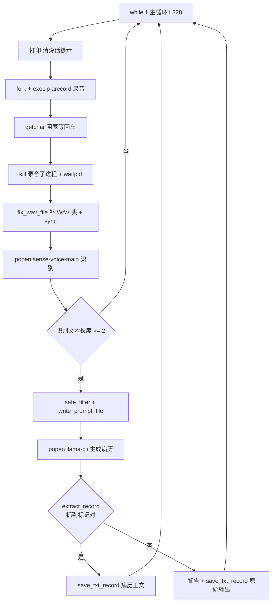

# loongson-medical-core 源码详解 02：核心子系统精读

> **涉及文件**
> - `embedded-application/assistant.c`（注释后 407 行）—— 本篇主角，8 个函数逐个过
> - `embedded-application/medical-platform/medical_platform.py`（注释后 223 行）—— GUI 三面板补充

---

## 1. assistant.c 函数地图

| 函数 | 行号 | 一句话职责 | 被谁调用 |
|---|---|---|---|
| `struct wav_header` | L44 | 44 字节 WAV 头的内存布局 | fix_wav_file |
| `fix_wav_file` | L69 | RAW PCM 补头成 WAV | main L344 |
| `clean_text` | L109 | STT 输出去标记/控制字符 | main L358 |
| `strrstr` | L131 | 从后往前找子串（自实现） | extract_record |
| `extract_record` | L151 | 抓最后一对 [病历开始]/[病历结束] | main L397 |
| `safe_filter` | L177 | 删 shell 危险字符 | main L370 |
| `save_txt_record` | L199 | 渲染 ASCII 病历并落盘 | main L398 / L401 |
| `write_prompt_file` | L264 | 写 ChatML prompt 到 /tmp | main L371 |
| `main` | L296 | 编排主循环 | GUI / 终端 |

主循环执行流：



## 2. 音频子系统：从裸 PCM 到 WAV

从缓冲区/文件的"数据载体"视角看一轮问诊，每个缓冲区都有固定容量与所有权：

```mermaid
flowchart LR
    A["/tmp/rec.raw<br/>arecord 直写 无上限"] -->|"fix_wav_file<br/>4KB 循环搬运"| B["/tmp/rec.wav<br/>44字节头+PCM"]
    B -->|"popen stdin/stdout"| C["raw_res 4KB<br/>main 局部 只收含[行"]
    C -->|"clean_text 状态机"| D["final_res 4KB"]
    D -->|"safe_filter 吞4类字符"| E["safe_input 2KB"]
    E -->|"fprintf 逐行"| F["/tmp/prompt.txt"]
    F -->|"llama-cli -f"| G["model_output 8KB<br/>strcat 前查容量"]
    G -->|"extract_record 钳位"| H["record_content 4KB"]
    H -->|"strtok 逐行"| I["bingli_时间戳.txt"]
```



### 2.1 WAV 头结构（L44-L63）

```c
// assistant.c L44-L63（节选）
struct wav_header {
    char riff[4];            /* "RIFF" 魔数 */
    int chunk_size;          /* 整个文件大小 - 8 */
    char wave[4];            /* "WAVE" 格式族 */
    char fmt[4];             /* "fmt " 子块标识（注意第 4 字节是空格） */
    int fmt_size;            /* PCM 固定为 16 */
    short audio_format;      /* 1 = 无压缩 PCM */
    short num_channels;      /* 单声道 */
    int sample_rate;         /* 16000 Hz，与 arecord 参数一致 */
    int byte_rate;           /* 每秒字节数 = sample_rate * block_align */
    short block_align;       /* 一帧字节数 = 通道数 * 位宽/8 */
    short bits_per_sample;   /* 16 bit 定点 */
    char data[4];            /* "data" 数据子块标识 */
    int data_size;           /* PCM 原始字节数 */
};
```

44 字节的来源：`riff/wave/fmt/fmt_size`（4+4+4+4）+ `audio_format/num_channels`（2+2）+ `sample_rate/byte_rate`（4+4）+ `block_align/bits_per_sample`（2+2）+ `data/data_size`（4+4）= **44**。字段顺序、偏移由 RIFF 规范钉死，`x86/LoongArch` 都是小端，直接 `fwrite(&header, ...)` 整块写即可。

### 2.2 fix_wav_file：补头 + 搬运（L69-L102）

```c
// assistant.c L73-L78（节选）
    int pcm_size = ftell(raw_f);   /* RAW 无头：文件总长就是 PCM 数据长 */
    fseek(raw_f, 0, SEEK_SET);     /* 回到文件头准备搬运数据 */
    // ...
    header.chunk_size = pcm_size + 36;  /* RIFF 规定 = 数据长 + 除本字段外的头 36 字节 */
```

两个魔法数字的来历：

- **36** = 44 - 4：`chunk_size` 从自身后面一个字段开始算，所以是整个头去掉 `riff[4]`+`chunk_size[4]` 共 8 字节后的 36 字节 + 数据长；
- **byte_rate = 32000**（L85）= sample_rate 16000 × block_align 2，即每秒 32000 字节；16 kHz 下 10 秒录音 = 32 万字节 ≈ 313 KB。

数据搬运用 4KB 缓冲循环（L93-L96），而不是一次 `fread` 全量——录音几十秒也就几百 KB，但这个写法对任意长度都安全。

```c
// assistant.c L93-L96
    char buffer[4096];                          /* 4KB 一段边读边写，控制内存占用 */
    size_t bytes;
    while ((bytes = fread(buffer, 1, sizeof(buffer), raw_f)) > 0)
        fwrite(buffer, 1, bytes, wav_f);
```

已知隐患（记录，未修改）：`wav_f = fopen(wav_path, "wb")` 之后没有判空（L91），磁盘满或权限异常时 `fwrite(NULL)` 会段错误。

### 2.3 录音参数三方一致性

录音参数在**两处硬编码、必须一致**，这是本工程最重要的隐式约定：

| 参数 | arecord 命令行（L335） | wav_header（L80-L86） |
|---|---|---|
| 采样率 | `-r 16000` | `sample_rate = 16000` |
| 通道 | `-c 1` | `num_channels = 1` |
| 位宽 | `-f S16_LE` | `bits_per_sample = 16` |
| 设备 | `-D plughw:1,0` | —— |

任何一处改动都要同步另一处，否则 SenseVoice 按错误采样率解码，识别全乱。

## 3. 文本清洗子系统

### 3.1 clean_text：双状态机过滤（L109-L122）

```c
// assistant.c L113-L118
    int i = 0, j = 0, in_b = 0, in_t = 0;   /* in_b: 在[]内  in_t: 在<>内 */
    while (input[i]) {
        if (input[i] == '[') in_b = 1;
        else if (input[i] == ']') in_b = 0;
        else if (input[i] == '<') in_t = 1;
        else if (input[i] == '>') in_t = 0;
        else if (!in_b && !in_t && (unsigned char)input[i] > 31) output[j++] = input[i];  /* 只保留区间外的可打印字符 */
        i++;
    }
```

- `in_b`/`in_t` 分别跟踪方括号、尖括号两种区间，SenseVoice 输出里的 `[TRANSCRIBE_START]`、`<|en|>` 之类的标记靠它们剥掉；
- `(unsigned char)input[i] > 31` 丢弃控制字符：**强转 unsigned 是关键**——`char` 在 LoongArch/Linux 默认有符号，UTF-8 中文首字节（0xC2~0xF4）强转前是负数，`> 31` 判断会误杀全部中文；强转后中文天然通过。

### 3.2 safe_filter：命令行注入防线（L177-L190）

```c
// assistant.c L180-L182
        if (src[i] == '"' || src[i] == '\\' || src[i] == '$' || src[i] == '`')
            { i++; continue; }   /* 双引号/反斜杠/美元符/反引号：shell 元字符，直接吞掉 */
        dst[j++] = src[i++];
```

删的是 `"`、`\`、`$`、`` ` `` 四类 shell 元字符。当前主路径（llama-cli `-f` 读文件）其实不拼命令行，这层是**纵深防御**：万一后续维护者把 `%s` 拼回 snprintf 的命令串，注入面已经被削平。

## 4. 病历提取子系统：strrstr + extract_record

### 4.1 为什么要 strrstr（L131-L141）

```c
// assistant.c L132-L137
    char *result = NULL;
    char *p = (char *)haystack;
    while ((p = strstr(p, needle)) != NULL) {
        result = p;
        p++;   /* 只前移 1 字节继续找：允许重叠匹配；needle 非空故不会死循环 */
    }
    return result;
```

模型经常把 system prompt 里的 one-shot 示例**原样复读一遍**，输出里会有两对 `[病历开始]/[病历结束]`：第一对是复述的示例，最后一对才是本次生成的病历。`strrstr` 取"最后一次出现"正对着后者。

### 4.2 extract_record 的四个防御动作（L151-L170）

```c
// assistant.c L154-L162
    if (!start || !end || end <= start) return 0;   /* end<=start: 标记不配对（如只复读了一次） */
    start += strlen("[病历开始]");
    while (*start == '\n' || *start == '\r') start++;   /* 跳过标记后紧随的空行 */
    int len = end - start;
    if (len >= out_size) len = out_size - 1;   /* 截断保护，给 '\0' 留 1 字节 */
    strncpy(out, start, len);
    out[len] = '\0';
    int k = strlen(out) - 1;
    while (k > 0 && (out[k] == '\n' || out[k] == '\r' || out[k] == ' ')) out[k--] = '\0';  /* 右去空白，病历更整洁 */
```

1. **配对校验**：任一标记缺失、或 `end <= start`（模型只输出了一对倒序标记）→ 返回 0 走兜底；
2. **跳过标记后的空行**；
3. **截断保护**：`len` 钳到 `out_size - 1`，4096 字节缓冲约容 1300+ 个汉字；
4. **右去空白**：尾部换行/空格清干净，落盘的病历不带尾空行。

## 5. Prompt 工程子系统：write_prompt_file（L264-L289）

```c
// assistant.c L268-L276
    fprintf(f, "<|im_start|>system\n");   /* 以下为 ChatML 的 system 段 */
    fprintf(f, "你是一个门诊病历生成助手。用第三人称医学术语，禁止使用\"您建议可能考虑\"。\n");  /* 负面词约束：压制口语化建议词 */
    fprintf(f, "输出格式：\n");
    fprintf(f, "[病历开始]\n");           /* one-shot 示例骨架，模型照此输出 */
    fprintf(f, "主诉：...\n");
    fprintf(f, "现病史：...\n");
    fprintf(f, "初步诊断：...\n");
    fprintf(f, "处理意见：...\n");
    fprintf(f, "[病历结束]<|im_end|>\n");
```

v3 的三个强化点：

1. **四段式 one-shot 骨架**：主诉/现病史/初步诊断/处理意见，用 `[病历开始]`/`[病历结束]` 夹住，与 extract_record 形成闭环；
2. **负面词约束**：`禁止使用"您建议可能考虑"`，压制 0.5B 小模型爱说的口语化建议词；
3. **文件尾部停在 `<|im_start|>assistant\n`**（L281）：prompt 是"已完成一半的对话"，模型接续写出的就是病历本体。

为什么写文件而不是拼进命令行参数？两点：prompt 含换行与中文，命令行转义极易翻车；`-f` 读文件长度不受 `ARG_MAX` 限制。

## 6. 病历渲染子系统：save_txt_record（L199-L252）

```c
// assistant.c L202-L206
    snprintf(filename, sizeof(filename), "/home/richard/bingli_%04d%02d%02d_%02d%02d%02d.txt",
             t->tm_year+1900, t->tm_mon+1, t->tm_mday, t->tm_hour, t->tm_min, t->tm_sec);
```

- 文件名 = 病历编号 = 秒级时间戳，`bingli_YYYYMMDD_HHMMSS.txt`；纯英文文件名避开编码问题（v3 修改点之一）；
- 路径硬编码 `/home/richard/`，换机部署要改（见 [04-构建运行与实测指南](04-构建运行与实测指南.md)）。

```c
// assistant.c L227-L233
    char buf[4096];
    strncpy(buf, record_raw, sizeof(buf)-1);   /* strtok 会原地改写缓冲，record_raw 是 const，必须先拷贝 */
    buf[sizeof(buf)-1] = '\0';
    char *line = strtok(buf, "\n");
    while (line) {
        fprintf(f, "|   %s\n", line);   /* 逐行补左边框；超宽不自动折行，打印前需人工检查 */
        line = strtok(NULL, "\n");
    }
```

`strtok` 的经典坑：它**原地改写**缓冲区（把分隔符换成 `\0`），而 `record_raw` 是 `const char *`——所以先 `strncpy` 到栈上 4KB，再切。病历正文每行补 `"|   "` 左边框，但**右边框不对齐**（没有按可见宽度 pad），超宽行也不折行，A4 打印前需人工检查——这是设计取舍，代码里没有做对齐计算。

## 7. GUI 三面板（medical_platform.py 补充）

| 面板 | 宽度 | 核心控件 | 交互 |
|---|---|---|---|
| 左（控制区） | 270px | 开始服务 / 发送指令 / 停止服务 | 状态机互锁（L149-L182） |
| 中（终端区） | 弹性 | Vte.Terminal，Monospace 10，回滚 5000 行 | 右键复制（L184-L195） |
| 右（病历区） | 290px | TextView + 保存按钮 | Enter 即保存（L197-L201） |

右侧保存的实现：

```python
# medical_platform.py L204-L216
    def on_save(self, btn):
        # 把右侧粘贴的病历文本整体写入桌面"病例.txt"（覆盖写）
        buf = self.tv_in.get_buffer()
        txt = buf.get_text(buf.get_start_iter(), buf.get_end_iter(), True)   # True = 含不可见字符
        if not txt.strip():
            return   # 空内容不落盘
        fname = os.path.join(DESKTOP, "病例.txt")
        try:
            with open(fname, "w", encoding="utf-8") as f:
                f.write(txt)
            buf.set_text("", -1)   # 成功后清空输入框，提示"已保存"
        except Exception as e:
            pass   # 已知隐患：异常被静默吞掉，用户得不到保存失败提示
```

一个值得注意的分工：assistant.c 的病历落盘是**时间戳多文件**（每轮问诊一个 bingli_*.txt），GUI 右侧是**固定名单文件覆盖写**（病例.txt）。两者互不干扰，右侧更像"人工剪贴板归档"。

## 8. 陷阱与实测建议

1. **改录音参数必改两处**：L335 的 arecord 参数与 L80-L86 的 WAV 头字段，漏一处识别必错。
2. **中文识别为空的排查顺序**：先看 `(unsigned char)` 强转还在不在（L116），再确认 `strchr(buffer, '[')` 过滤（L355）没把结果行滤掉。
3. **病历抓空的兜底**：extract_record 失败时整段 model_output 落盘（L401），若经常走到这一支说明模型没守格式，优先检查 prompt 文件内容是否被旧文件污染。
4. **模型输出缓冲 8KB 上限**（L391 有容量守卫）：`-n 128` 限制生成 128 token，正常不会触顶；若调大 `-n`，同步检查 model_output 8KB 与 record_content 4KB 的容量链。
5. GUI 侧 `on_save` 的 `except: pass`（L215-L216）会吞保存失败，实测时保存后到桌面确认文件 mtime。
