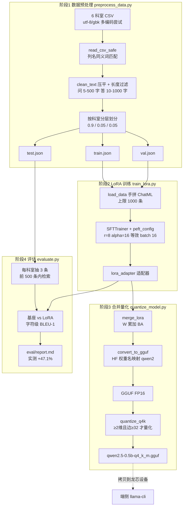

# loongson-medical-core 源码详解 03：数据流与接口协议

> **涉及文件**
> - `embedded-application/assistant.c`（注释后 407 行）
> - `model-training/scripts/preprocess_data.py`（注释后 194 行）
> - `model-training/scripts/train_lora.py`（注释后 169 行）
> - `model-training/scripts/quantize_model.py`（注释后 205 行）
> - `model-training/scripts/quantize_iq1s.py`（注释后 121 行）
> - `model-training/scripts/evaluate.py`（注释后 216 行）

本篇是全工程的"接口手册"：端侧与训练侧之间靠 **4 份协议**咬合——WAV/RIFF、ChatML、stdout 文本、GGUF。任何一端单独改动而不同步协议，系统就会静默错位。

---

## 1. 协议总表

| # | 协议 | 载体 | 生产者 | 消费者 | 单向/双向 |
|---|---|---|---|---|---|
| P1 | WAV/RIFF 44 字节头 | `/tmp/rec.wav` | assistant.c fix_wav_file | sense-voice-main | 单向 |
| P2 | ChatML 对话模板 | `/tmp/prompt.txt` + 训练 JSON | write_prompt_file / preprocess_data | llama-cli / train_lora | 单向 |
| P3 | stdout 文本行协议 | Vte PTY | assistant.c printf | GUI 用户眼睛 | 单向 |
| P4 | GGUF（头+KV+张量） | `.gguf` 文件 | quantize_model.py | llama-cli | 单向 |
| P5 | PTY 字节注入 | `feed_child` | GUI 按钮 | assistant.c getchar | 单向 |

## 2. P1：WAV/RIFF 音频协议

fix_wav_file（assistant.c L69）按 RIFF 规范填 44 字节头，字段级协议如下（**采样参数必须与 L335 的 arecord 命令行一致**）：

| 偏移 | 字段 | 值 | 说明 |
|---|---|---|---|
| 0 | riff[4] | `RIFF` | 魔数 |
| 4 | chunk_size | pcm_size + 36 | 文件总长 - 8 |
| 8 | wave[4] | `WAVE` | 格式族 |
| 12 | fmt[4] | `fmt `（第 4 字节空格） | 子块 ID |
| 16 | fmt_size | 16 | PCM 固定 |
| 20 | audio_format | 1 | 无压缩 |
| 22 | num_channels | 1 | arecord `-c 1` |
| 24 | sample_rate | 16000 | arecord `-r 16000` |
| 28 | byte_rate | 32000 | 16000 × 2 |
| 32 | block_align | 2 | 16bit 单声道 |
| 34 | bits_per_sample | 16 | S16_LE |
| 36 | data[4] | `data` | 数据子块 |
| 40 | data_size | pcm_size | ftell 反推 |

量化视角：16 kHz × 2 字节 = 32 KB/s，一段 10 秒主诉约 313 KB 裸 PCM，封装后 44 字节增量可忽略。

## 3. P2：ChatML 对话模板（三处手拼，一处真相）

ChatML 是本工程横跨端侧与训练侧的核心协议。Qwen2.5 系列格式：每条消息 `\<\|im_start\|\>角色\n内容\<\|im_end\|\>`，生成起点是 `\<\|im_start\|\>assistant\n`。工程里**三处代码各自手拼**：

| 位置 | 拼法 | 用途 |
|---|---|---|
| preprocess_data.py L46 | user 内容前缀 `【科室：xx】\n` | 训练样本 user 段 |
| train_lora.py L90 | `f"\<\|im_start\|\>{role}\n{content}\<\|im_end\|\>"` | 训练文本化 |
| assistant.c L268-L281 | fprintf 逐行写 system+user+assistant 起点 | 端侧推理 prompt |

训练样本的标准结构（preprocess_data.py L43-L55）：

```python
# preprocess_data.py L46-L55
    user_content = f"【科室：{department}】\n{question}"

    # 输出结构 = OpenAI messages 风格，与 Qwen 的 ChatML 三角色一一对应
    return {
        "messages": [
            {"role": "system", "content": SYSTEM_PROMPT},
            {"role": "user", "content": user_content},
            {"role": "assistant", "content": answer}
        ]
    }
```

端侧 prompt 的组装协议（assistant.c write_prompt_file，L264）：

| 段 | 内容 | 协议要点 |
|---|---|---|
| system | 医疗病历人设 + 负面词约束 + 四段式 one-shot 骨架 | `\[病历开始\]…\[病历结束\]` 夹住示例 |
| user | 患者主诉（经 safe_filter） | 无任何示例污染 |
| 收尾 | `\<\|im_start\|\>assistant\n` | 停在这里等模型续写 |

**一致性风险**：训练时模型学到的 system prompt（preprocess_data.py L30）与端侧 write_prompt_file 写入的 system 段是**两份不同的文本**。0.5B 模型对 system 措辞敏感，端侧输出格式全靠 one-shot 骨架撑住——这就是 extract_record 失败率的主要来源。

## 4. P3/P5：stdout 文本协议与 PTY 注入

assistant.c 往 stdout 打的文本就是 GUI 的"API"：

| 前缀/标记 | 例子 | GUI 侧意义 |
|---|---|---|
| `[系统]` | `[系统] 正在生成病历...` | 状态提示 |
| `[你]:` | `[你]: 头痛三天了` | 回显识别结果 |
| `>>> 请说话… <<<` | L329 | 等待录音提示 |
| `bingli_*.txt` 路径 | L370 打印 | 病历落盘通知 |

反向只有两个字节：GUI `feed_child(b"\n")`（medical_platform.py L169）唤醒 `getchar()`；`feed_child(b"\x03")`（L174）= Ctrl+C 终结 assistant。

## 5. 训练侧数据流全图



### 5.1 一条训练样本的旅程

从原始 CSV 行到端侧推理，同一条数据在 8 种载体间流转：


### 5.2 预处理：多编码 CSV 的防御式读取（preprocess_data.py L58）

```python
# preprocess_data.py L66-L72
    # 尝试多种编码：上游数据来自多人整理，编码不统一是常态；
    # latin-1 放最后兜底（任何字节流都能解，保证函数有返回内容）
    content = None
    for enc in ['utf-8', 'gbk', 'gb2312', 'gb18030', 'latin-1']:
        try:
            with open(filepath, 'r', encoding=enc) as f:
                content = f.read()
            break
        except (UnicodeDecodeError, UnicodeError):
            continue
```

列名匹配用同义词表（L95-L102）：`ask/question/input` 都映射到问句列，`answer/output/response` 映射到答句列，容忍上游 CSV 的列名漂移。长度过滤（L116-L121）上下界各有理由：下界滤掉无信息量碎句；上界 500/1000 字是给 512 token 训练窗口留余量（汉字约 1 字 ≈ 1 token 上下）。

### 5.3 LoRA 训练：只训 0.x% 参数（train_lora.py L26-L34）

```python
# train_lora.py L26-L34
lora_config = LoraConfig(
    r=8,
    lora_alpha=16,
    target_modules=["q_proj", "k_proj", "v_proj", "o_proj", "gate_proj", "up_proj", "down_proj"],
    lora_dropout=0.05,   # 轻度 dropout 抑制小数据过拟合
    bias="none",         # 不训练偏置，只训低秩旁路
    task_type="CAUSAL_LM",
)
```

内存/规模量化：Qwen2.5-0.5B fp32 全量约 2 GB；LoRA 注入 7 类线性层（注意力 4 + MLP 3），r=8 时每层新增 2×8×d 的 A/B 矩阵，0.5B 模型可训参数占比 <1%。等效 batch = `per_device 1 × grad_accum 16 = 16`（L41-L42），warmup 50 步，lr 2e-4（LoRA 专用区间，比全参微调大一个量级）。

### 5.4 GGUF 转换：HF 命名 → llama.cpp 命名（quantize_model.py L50）

元数据翻译表（L66-L81）是 P4 协议的关键段：

```python
# quantize_model.py L66-L81（节选）
    writer.add_uint32(K.Attention.HEAD_COUNT, cfg["num_attention_heads"])
    writer.add_uint32(K.Attention.HEAD_COUNT_KV, cfg["num_key_value_heads"])   # GQA：2 个 KV 头对 14 个 Q 头
    writer.add_uint32(K.LLM.BLOCK_COUNT, n_layers)
    writer.add_uint32(K.LLM.EMBEDDING_LENGTH, cfg["hidden_size"])              # Qwen2.5-0.5B = 896
    # ...
    writer.add_uint32(K.Tokenizer.BOS_ID, cfg.get("bos_token_id", 151643))
    writer.add_uint32(K.Tokenizer.EOS_ID, cfg.get("eos_token_id", 151645))
    writer.add_uint32(K.Tokenizer.PAD_ID, tok.get("pad_token_id", 151643))
```

张量循环里两处判定决定量化质量（L146-L152）：

```python
# quantize_model.py L146-L152
        # 一维的 norm/bias、小张量保持 F16（块量化最小块 256，太小没法分块）
        is_weight = data.ndim >= 2 and max(data.shape) >= 32

        if is_weight:
            try:
                qtype = GGMLQuantizationType.Q4_K
                quantized = gguf_quantize(data, qtype)
```

- **量化门槛**：≥2 维且最大边 ≥32——一维 norm/bias 与小张量保持 F16 无损；
- **失败降级**：单张量化失败只打 Warning 降回 F16，不中断整条流水线。

### 5.5 quantize_iq1s.py 与 quantize_model.py 的关系

两者做同一件事（FP16 GGUF → Q4_K），是**同一协议的两种实现**：

| | quantize_model.py quantize_q4k | quantize_iq1s.py main |
|---|---|---|
| 元数据搬运 | `writer.add_field(field)` 批量 | 逐字段 `add_key_value`（L54），跳过 7 个结构性字段（L30-L33） |
| 使用场景 | 主流水线第 3 步 | 独立重跑/绕旧版 gguf 库兼容问题 |
| is_weight 判定 | `data.ndim >= 2 and max(data.shape) >= 32`（L147） | `len(shape) >= 2 and max(shape) >= 32`（L93） |

文件头注释里记录了动机：Qwen2.5-0.5B hidden_size=896，896 % 256 ≠ 0（K-quant 块大小 256），Python gguf 库在某些版本下不能直接处理，于是有了手工搬元数据的独立实现。

### 5.6 评估：对称 A/B + 简易 BLEU（evaluate.py）

```python
# evaluate.py L54-L61
    # 注意：这是"字符集合重叠率"，不是标准 BLEU（无 n-gram、无短惩罚），
    # 只能用于同条件下两模型的相对比较，绝对值无语言学意义
    ref_chars = set(reference)
    cand_chars = set(candidate)
    if not cand_chars:
        return 0.0   # 空输出记 0 分，不参与 NaN
    overlap = len(ref_chars & cand_chars)
    return overlap / len(cand_chars)
```

抽样协议（L76-L88）：测试集前 500 条内扫描，从 user 首行 `【科室：xx】` 抠科室名，每科室最多 3 条——CPU 推理一条约几秒到十几秒，总样本约 6~18 条可控在分钟级。基座先测、`del` 释放（L121-L122）再测 LoRA，两条循环的 prompt 构造完全对称（L114 / L149 都是 `format_prompt(msgs[:-1]) + "<|im_start|>assistant\n"`）。

生成参数（L28-L44）用 Qwen2.5 官方推荐采样：temperature 0.7 / top_p 0.8 / top_k 20，`do_sample=True`；输出切掉 prompt 回显只留续写段（L46）。

## 6. 训练产物接口对账表

| 产物 | 生产者 | 消费者 | 格式要点 |
|---|---|---|---|
| `data/train/val/test.json` | preprocess_data.py | train_lora.py / evaluate.py | `messages` 三角色数组，`ensure_ascii=False` |
| `lora_adapter/` | train_lora.py | quantize_model.py / evaluate.py | PEFT 标准目录（adapter_config.json 等） |
| `merged_model/` | quantize_model.py 第 1 步 | 第 2 步 | safetensors + config 六件套补齐（L39-L45） |
| `qwen2.5-0.5b-f16.gguf` | 第 2 步 | 第 3 步 | GGUF 三段式，MOSTLY_F16 |
| `qwen2.5-0.5b-q4_k_m.gguf` | 第 3 步 | 端侧 llama-cli | MOSTLY_Q4_K，写到 `/home/richard/` |
| `eval/report.{json,md}` | evaluate.py | 人工 | 平均分 + 逐科室 + 5 组样例对比 |

## 7. 陷阱小结

1. **三处 ChatML 手拼无单一来源**：改模板（如换模型家族）要同步 preprocess_data.py L46 附近、train_lora.py L90、assistant.c L268-L281 三处。
2. **训练 system prompt ≠ 端侧 system prompt**：端侧格式稳定性依赖 one-shot 骨架，换模型后优先检查 extract_record 命中率。
3. **GGUF 元数据 BOS/EOS 缺省值**（quantize_model.py L79-L80）写死为 Qwen2 家族的 151643/151645，换基座要重核。
4. **evaluate.py 科室名解析 bug**：`split("：")[1]` 保留尾部 `】`，报告里科室显示"早泄】"（见 outputs/eval/report.md），不影响打分只影响分组展示。
