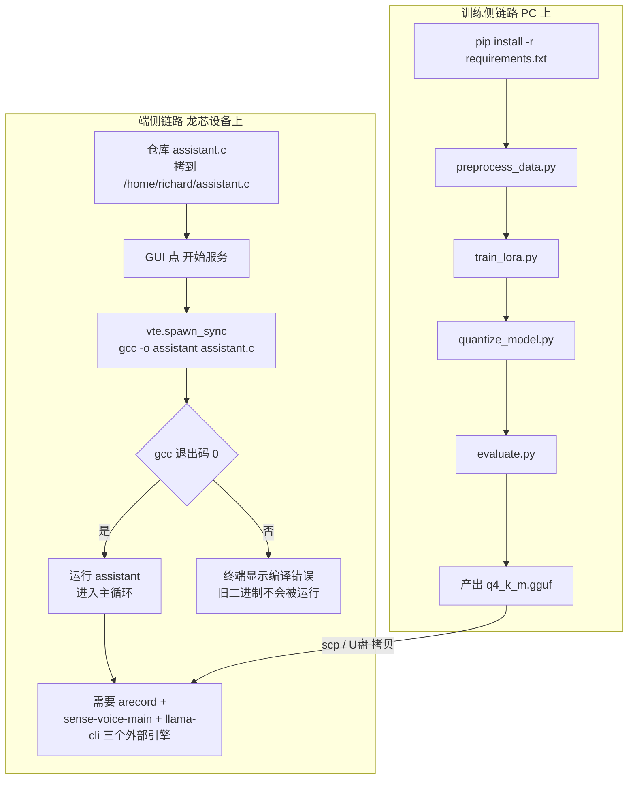
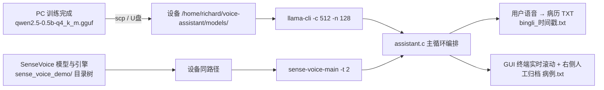

# loongson-medical-core 源码详解 04：构建运行与实测指南

> **涉及文件**
> - `embedded-application/assistant.c`（注释后 407 行）
> - `embedded-application/medical-platform/medical_platform.py`（注释后 223 行）
> - `embedded-application/medical-platform/run.sh`、`loongson-medical-platform.desktop`
> - `model-training/scripts/`（5 个脚本）、`model-training/requirements.txt`、`model-training/outputs/eval/report.md`

---

## 1. 两条构建链路

工程有两条互不相干的构建链路：**端侧**（龙芯设备上 gcc + python 即用）和 **训练侧**（PC/服务器上跑完整流水线，产物拷到设备）。本仓库的 `.gguf` 与 `data/processed/*.json` 都是 Git LFS 指针，`git clone` 后必须 `git lfs pull`（或按第 3 节自己重训）。



## 2. 端侧部署核对清单

部署就是把仓库文件摆到 C 代码写死的路径上。**路径硬编码核对表**（逐项来自源码）：

| 路径 | 写死在 | 用途 |
|---|---|---|
| `/home/richard/assistant.c` | medical_platform.py L17 | 编译输入 |
| `/home/richard/assistant` | L18 | 编译输出/运行 |
| `/home/richard/sense_voice_demo/lib` | medical_platform.py L103、assistant.c L308 | SenseVoice 动态库 |
| `/home/richard/sense_voice_demo/bin/sense-voice-main` | assistant.c L348-L352 | 语音识别引擎 |
| `/home/richard/sense_voice_demo/models/sense-voice-small-q4_k.gguf` | L350 | 识别模型 |
| `/home/richard/llama-cli` | L374-L378 | 推理引擎 |
| `/home/richard/voice-assistant/models/qwen2.5-0.5b-instruct-q4_k_m.gguf` | L376 | 对话模型 |
| `/home/richard/bingli_*.txt` | L203 | 病历输出目录 |
| `/tmp/rec.raw`、`/tmp/rec.wav`、`/tmp/prompt.txt` | L297-L298、L265 | 运行期临时文件 |

系统依赖（apt 侧，不在仓库内）：`gcc`、`alsa-utils`（arecord）、GTK3 + Vte 2.91 + PyGObject（GUI）、bash。声卡假设：`plughw:1,0`（assistant.c L335），即第 2 块声卡——`arecord -l` 先确认 USB 麦克风序号，不是 1,0 就要同步改源码。

运行方式三选一：

```bash
# 方式一：桌面图标（.desktop 已装时）
#   系统菜单 → 龙芯智慧医疗平台

# 方式二：脚本（首次排障推荐）
cd /home/richard/医疗平台 && bash run.sh

# 方式三：只跑 C 核心（不要 GUI，用终端回车代替按钮）
gcc -o /home/richard/assistant /home/richard/assistant.c && /home/richard/assistant
```

单轮问诊的操作节奏：点"开始服务" → 看到 `>>> 请说话描述症状...` → 对麦克风说话 → 点"发送指令"（= 回车）→ 等 `[系统] 病历已保存`。

## 3. 训练侧复现步骤

环境（model-training/requirements.txt）：torch ≥2.0、transformers ≥4.43、peft ≥0.10、trl ≥1.7、datasets ≥2.14、safetensors ≥0.4、gguf ≥0.19、numpy ≥1.24、accelerate ≥0.21。

```bash
cd model-training
# 0. 准备模型目录：scripts 设计为"在基座模型目录里运行"（MODEL_PATH="."）
cp scripts/*.py models/base/           # 或 cd models/base 后用相对路径指向 ../../scripts
# 1. 数据：下载 Chinese-medical-dialogue 到 scripts 同级的
#    shujuji/Chinese-medical-dialogue-data-master/Data_数据/
python3 preprocess_data.py             # 产出 data/train|val|test.json（注意脚本内 OUT_DIR="data" 相对 cwd）
# 2. 训练（CPU 数小时级；1000 条 × 3 epoch，等效 batch 16）
python3 train_lora.py
# 3. 合并 + 转换 + 量化（四步幂等，可断点重跑）
python3 quantize_model.py
# 4. 评估 A/B 对比
python3 evaluate.py
```

注意事项：

- `MODEL_PATH = "."`（train_lora.py L19）：脚本要在**含 config.json/tokenizer/权重的目录**里执行，否则 from_pretrained 找不到模型；
- `preprocess_data.py` 的 `DATA_DIR`/`OUT_DIR` 都是相对 cwd 的 Path（L14-L15），执行位置不同产物落点不同；
- 0.5B fp32 全量驻留约 2 GB 内存 + 激活，8 GB 内存机器可跑；
- `quantize_model.py` 每步开头都有"已存在则跳过"判断（L29、L52），中途失败直接重跑整脚本即可。

## 4. 实测数据（outputs/eval/report.md 摘录）

| 指标 | 原始 Qwen2.5-0.5B | LoRA 微调后 | 提升 |
|---|---|---|---|
| 平均 BLEU-1（字符级） | 0.2409 | 0.3543 | **+47.1%** |

报告里的定性观察（样例对比节选）：

- **原始模型**：回答通用健康建议（"保持良好生活习惯、适当锻炼"），长而泛；
- **微调模型**：口语化诊療口吻（"你好，根据你的叙述，考虑是肾虚引起的……"），贴近训练集风格，短句密度高。

对 BLEU-1 数字本身的解读要克制：evaluate.py 的打分是**字符集合重叠率**（L52-L61），无 n-gram 与长度惩罚，绝对值只在本工程 A/B 条件下可比。训练侧真正说服人的是"风格向训练集收敛"这个定性结论 + 47.1% 的相对变化。

实测建议（复现时按序验证）：

1. 先跑 `evaluate.py` 的原始模型段（前半流程），确认推理栈通；
2. `NUM_SAMPLES`/抽样逻辑（每科室 3 条）不改时，单次评估约 6~18 条 × 每条数秒~十几秒；
3. 对比 `report.json` 里 `base_results` 与 `lora_results` 的逐条 BLEU，定位提升主要来自哪类问题。

## 5. 端到端部署数据流（训练产物 → 设备）



时延量级估算（端侧全程离线）：录音取决于说话时长；SenseVoice 识别 10 秒音频约 1~3 秒（-t 2 双线程）；llama-cli 生成 128 token，0.5B Q4_K 在龙芯上按每秒数 token 计约半分钟内——一次完整问诊的"说话结束 → 病历落盘"大约 30~60 秒量级。

## 6. 复现后的回归核对清单

按序执行、逐项打勾，可确认部署与训练产物完好：

```bash
# 1. 产物存在性与体积（体积突然变小说明量化/拷贝不完整）
ls -lh /home/richard/voice-assistant/models/*.gguf
# 2. 推理引擎冒烟：不进 GUI 直接跑一次对话
echo -e "<|im_start|>user\n头痛三天<|im_end|>\n<|im_start|>assistant" > /tmp/p.txt
/home/richard/llama-cli -m /home/richard/voice-assistant/models/qwen2.5-0.5b-instruct-q4_k_m.gguf \
  -c 512 -n 64 -t 2 --log-disable -f /tmp/p.txt
# 3. 语音链路冒烟：手工录 3 秒并识别
arecord -D plughw:1,0 -r 16000 -c 1 -f S16_LE -t raw -d 3 /tmp/t.raw
#    用 assistant.c 同款头封装后喂 sense-voice-main（或直接跑一轮 GUI）
# 4. GGUF 元数据抽查（PC 上）
python3 -c "from gguf.gguf_reader import GGUFReader; r=GGUFReader('qwen2.5-0.5b-q4_k_m.gguf'); \
  print(r.get_field('general.architecture').parts[-1], len(r.tensors))"
# 5. 评估复现：report.json 的 improvement_pct 应为正
```

故障注入实测建议（验收鲁棒性）：拔掉 USB 麦克风后跑一轮（应"没听清"而非段错误——注意 fix_wav_file 的 wav_f 隐患在 /tmp 可写时不触发）；`/tmp` 塞满后跑一轮（会踩 L91 未判空的坑，属已知问题）；GUI 快速连点"开始/停止"（验证 pidof 清场）。

## 7. 性能基线与调参方向

端侧推理参数集中在 assistant.c L374-L378 的 llama-cli 命令行，每个旋钮的影响与计算依据：

| 参数 | 当前值 | 调大 | 调小 |
|---|---|---|---|
| `-c`（ctx） | 512 | KV cache 显存/内存按 token 数线性涨：0.5B GQA（2 KV 头 × head_dim 64 × 24 层 × 2(K,V) × 2 字节 fp16）≈ 每 token 约 12 KB；512 ≈ 6 MB，2048 ≈ 24 MB | prompt 装不下时截断，病历格式更易崩 |
| `-n`（生成长度） | 128 | 病历更完整，时延线性涨（约每 token 数十 ms 量级起步） | 四段式写不完，extract_record 失败率升 |
| `-t`（线程） | 2 | 龙芯核多可涨，收益受内存带宽封顶 | 时延翻倍 |
| `-np`/`--log-disable` | 静默 | —— | 日志混入 stdout 会污染提取链路 |

训练侧调参（train_lora.py）：

- 等效 batch 16 = batch 1 × 累积 16（L41-L42）：显存/内存不够时优先降 batch 保累积，总步数 = ceil(样本数/16) × epoch 不变；
- `MAX_TRAIN_SAMPLES=1000`（L65）：数据敏感，扩数据是第一位——0.3543 的 BLEU-1 主要受限于 1000 条样本；
- `learning_rate=2e-4`（L48）：LoRA 区间，震荡则先砍半再查 `max_grad_norm=0.3`（L52）；
- 每 epoch ≈ 63 步、总 ~189 步 < `eval_steps=200`：**当前配置下验证/最优回载实际未生效**，扩数据后自动激活。

## 8. 首次部署 60 分钟路线图

按时间顺序的动手清单（端侧已有训练产物为前提）：

| 时间 | 动作 | 完成标志 |
|---|---|---|
| 0-10 min | 装系统依赖：gcc、alsa-utils、GTK3/Vte/PyGObject；`arecord -l` 确认声卡序号 | 麦克风设备号 = plughw:1,0 或改源码 |
| 10-20 min | 摆文件：对照第 2 节路径核对表逐行落位 | 所有 `/home/richard/...` 路径存在 |
| 20-25 min | 冒烟 llama-cli 与 sense-voice-main（第 6 节命令） | 两个引擎各自出正确输出 |
| 25-35 min | GUI 首跑：run.sh → 点"开始服务" | 终端出现横幅与录音提示 |
| 35-45 min | 全链路一轮：说话 → 发送指令 → 病历落盘 | `bingli_*.txt` 出现且含四段式 |
| 45-60 min | 异常路径：空输入/连点开始/停止再开始 | 不留残留进程、可继续服务 |

## 9. 陷阱与排障速查

| 症状 | 排查点 |
|---|---|
| GUI 起不来，报 Vte 版本 | `gi.require_version('Vte','2.91')` 对应的系统包是否安装（L11） |
| 点开始服务无反应 | 看 Vte 终端里的 gcc 报错；`LAUNCH_CMD` 的 `&&` 保证编译失败不运行 |
| 识别结果为空 | `LD_LIBRARY_PATH`（L103/L308 双处）、声卡序号 `plughw:1,0`（L335）、`/tmp/rec.wav` 是否非 0 字节 |
| 病历输出"警告：模型未按格式输出" | `/tmp/prompt.txt` 是否为最新（write_prompt_file 打开失败会静默用旧文件，L265-L267） |
| 模型加载报 KeyError: qwen2 | transformers < 4.37 的已知问题（基座 README 有说明），升级 requirements 下限版本 |
| 量化脚本在 896 维上炸 | 用 quantize_iq1s.py 的手工路径；失败张量自动降级 F16（L93-L101） |
| 桌面没有生成 病例.txt | GUI on_save 吞异常（L215-L216），检查桌面路径写权限与文件 mtime |
| 磁盘满后段错误 | fix_wav_file 未判 wav_f 空指针（L92），先清理 /tmp 与 /home/richard 的 bingli_*.txt |

## 10. 合规提醒

assistant.c 生成的每份病历尾部都印有固定声明（save_txt_record 内）：**本病历由 AI 语音助手辅助生成，仅供执业医师参考，不具有独立诊断和法律效力，须由执业医师签字确认生效**。这是工程内置的合规边界，任何功能扩展都不应移除。

与之配套的两处设计同样属于合规链路：病历表头固定标注"医生：AI 辅助 / 需执业医师审核签字"与"科室：全科门诊"，以及 GUI 右侧的病历归档（病例.txt）保留人工粘贴环节——机器输出到法律文书之间始终隔着一道人工确认。
